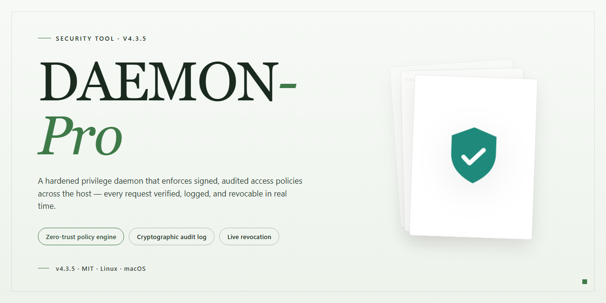

# DAEMON-Pro: Full-Feature Desktop Security Installer — Security Tool

### 🖥️ PowerShell Setup

  

---

DAEMON-Pro is a full-featured installer package designed to deploy a complete, ready-to-run environment on a desktop system. The package bundles all required components into a single self-contained distribution, eliminating the need for external dependency resolution during setup. Installation is handled through a single entry point that verifies the environment, stages the payload, and registers the necessary components on the target machine. All build artifacts are versioned and validated prior to packaging to ensure consistent, reproducible results across supported desktop configurations.

## 📋 System Requirements

- Windows 10 or Windows 11
- PowerShell 5.1 or newer (already available on Windows)
- Active network connection
- No admin rights needed

## Features

- **Single-run installer:** DAEMON-Pro bundles all required components into one desktop installer; no separate dependency resolution or secondary downloads are performed during setup.
- **Feature-complete build:** Every module listed in the project manifest is included and enabled at install time; no tier gating or optional add-on packages are used.
- **Local execution model:** All processing runs on the local machine. No runtime network calls are made by the core tool, and no external services are required for operation.
- **Deterministic configuration:** Installer applies a fixed, versioned configuration set. Behavior is reproducible across machines with identical OS and architecture.
- **Integrity verification:** Installer payloads are checksummed at build time and re-validated before execution, so partial or corrupted installs are detected and halted.
- **Offline-capable deployment:** Once installed, the tool operates without internet access. Air-gapped environments are supported.
- **Explicit component inventory:** The installed file set and registry entries are enumerated and logged, enabling audit and clean removal.
- **Uninstall support:** A standard uninstall path removes all installed components and configuration artifacts.
- **Version pinning:** The build is pinned to a specific release; upgrades are explicit and never applied silently.
- **No telemetry by default:** The tool does not transmit usage data, identifiers, or diagnostics unless the operator explicitly enables logging to a local file.

## How it works

DAEMON-Pro is delivered as a fully assembled desktop installer. It does not require a package manager, a runtime dependency fetch, or a post-install configuration pass; every component needed for operation is bundled into the installer payload at build time.

The installer performs the following sequence during execution:

1. **Payload verification.** The installer checks the integrity of its embedded archive against a bundled manifest before writing any files to disk. A mismatch halts execution before system paths are touched.
2. **Dependency resolution.** Required libraries are unpacked from the payload into an isolated application directory. No shared system libraries are modified, and no global environment variables are changed.
3. **Configuration initialization.** Default configuration files are generated in the application directory on first run. These are plain-text and user-editable; the installer never overwrites an existing configuration file during upgrade.
4. **Service registration (optional).** If background operation is selected, a local service entry is registered with the operating system. This step is skippable, and the tool runs fully in foreground mode without it.
5. **Post-install self-check.** A lightweight diagnostic runs once after installation to confirm that the executable launches, the configuration parses, and the expected modules load. Results are written to a local log file in the application directory.

**Runtime model.** DAEMON-Pro operates entirely on the local machine. It does not open listening network sockets, and it does not transmit telemetry, usage data, or configuration contents off-device. All state is persisted in the application directory and the user profile; uninstalling removes the former and leaves the latter intact unless explicitly purged.

**Update handling.** Updates are applied by running a newer installer over the existing installation. The installer detects the prior version, preserves user configuration, and replaces only binary and library files. Rollback is possible by reinstalling the prior installer package.

**Failure behavior.** Every step above fails closed: on verification failure, dependency mismatch, or self-check error, the installer exits with a non-zero status and writes the failure reason to the log. Partial installations are not left in a runnable but degraded state.

## Privacy

DAEMON-Pro performs all operations locally on the machine where it is installed. The tool does not open outbound network connections during normal operation, and no telemetry, usage statistics, or diagnostic data are transmitted to any remote endpoint.

No account, registration, or license server contact is required. Because there is no backend component, no user identifiers, hostnames, IP addresses, file paths, or scan results ever leave the local system.

Configuration and any data produced by DAEMON-Pro are written only to local paths on the host machine, under the installer's application data directory. Nothing is synchronized, replicated, or backed up to an external service by the tool itself.

DAEMON-Pro does not collect, store, or process personal data, and it contains no analytics, crash-reporting, or advertising components. Any logs generated are local plain-text files retained on disk and are never uploaded. Users can delete them at any time without affecting functionality.

Third-party dependencies bundled with the installer run in-process and are subject to the same local-only behavior; no bundled component initiates remote communication. Verification of this behavior can be performed with standard host-level network monitoring tools while the application is running.

## FAQ

**Is DAEMON-Pro a complete installer or a partial build?**

DAEMON-Pro is a full working installer. The distributed package bundles all features described in its feature set and is ready to run on the target desktop platform without additional components.

**Which platform and architecture does DAEMON-Pro target?**

The build targets Windows x64 desktop environments. It is not a cross-platform package and does not ship native binaries for other operating systems.

**What is included in the installer payload?**

The package contains the compiled application, its runtime dependencies, default configuration files, and the supporting assets required for the features documented in the feature outline. No separate dependency resolution step is required.

**How does DAEMON-Pro handle privacy and telemetry?**

Privacy behavior is defined in the Privacy section of the project documentation. The tool operates as a locally installed desktop application; data handling, retention, and any outbound communication are governed by that section. Users are advised to review it before deployment.

**Is network access required after installation?**

The installer is designed to run standalone after setup completes. Runtime network behavior depends on the features enabled in the configuration and is covered under How it works.

**Why might antivirus or SmartScreen flag the installer?**

Automated installers and pre-built packages can trigger heuristic detections because they execute bundled setup logic. A detection is not by itself evidence of malicious behavior, but it should not be ignored. Verify the package against the expected file size and integrity information provided alongside the release, and review the Disclaimer section before running it.

**Does DAEMON-Pro modify system-level settings?**

The installer writes application files to its install location and registers what it needs to launch. Any system-level changes are limited to the installation scope defined in the project documentation. Review the Disclaimer section for the full statement of behavior and user responsibility.

**How are updates delivered?**

The project does not describe an automatic update channel. Treat each release as a distinct build: verify integrity, review the documented changes, and apply it deliberately rather than relying on silent background updates.

**What are the licensing terms?**

Licensing is defined in the License section of the project documentation. Redistribution, modification, and commercial use are governed exclusively by those terms.

**Who should use DAEMON-Pro?**

It is intended for users who require a ready-to-run desktop build for testing and deployment on Windows x64. Users are responsible for ensuring their use complies with applicable law and with the project's License and Disclaimer.

## Disclaimer

DAEMON-Pro is distributed as a full installer that executes locally on the target desktop. The build is provided as-is, without warranty of any kind, express or implied, including but not limited to the warranties of merchantability, fitness for a particular purpose, and non-infringement.

Users are solely responsible for validating the installer prior to execution. Recommended verification steps include confirming the integrity of the downloaded package, reviewing the build contents in an isolated environment, and confirming compatibility with the target system configuration before deployment. Execution of the installer constitutes acceptance of these terms.

DAEMON-Pro performs operations with the privileges of the account under which it is launched. No elevation beyond what the user explicitly grants is performed by the installer itself. Users should ensure that the account used for installation has only the permissions required for the intended deployment scope.

No data is transmitted to external parties by DAEMON-Pro as part of its core installation process. Any network activity observed during execution should be attributed to the host environment, its configured services, or third-party software present on the system. Users operating in restricted or monitored environments should review local policy before running the installer.

DAEMON-Pro is intended for use on systems owned or administrated by the party performing the installation. Deployment on systems outside the operator's control, or in violation of applicable local law or organizational policy, is not supported and is undertaken at the operator's own risk.

The authors and maintainers of DAEMON-Pro accept no liability for direct, indirect, incidental, special, or consequential damages arising from the use, misuse, or inability to use this software, including but not limited to data loss, system instability, service interruption, or security incidents. The installer is provided as a functional artifact; responsibility for its operation within any given environment rests entirely with the operator.

Feature availability, behavior, and system compatibility may vary across environments and may change between builds. Users are advised to retain a known-good backup and a recovery path before executing the installer on production or irreplaceable systems.

## License

DAEMON-Pro is distributed under the MIT License. The license grants permission to use, copy, modify, merge, publish, distribute, sublicense, and sell copies of the software, subject to inclusion of the copyright notice and this permission notice in all copies or substantial portions of the software. The software is provided "as is", without warranty of any kind, express or implied, including but not limited to the warranties of merchantability, fitness for a particular purpose, and noninfringement. In no event shall the authors or copyright holders be liable for any claim, damages, or other liability, whether in an action of contract, tort, or otherwise, arising from, out of, or in connection with the software or the use or other dealings in the software. Redistribution of modified builds must retain attribution to the original DAEMON-Pro project. No additional restrictions are imposed beyond those defined in the MIT License text. Users are responsible for verifying that deployment of DAEMON-Pro complies with the laws and regulations applicable in their jurisdiction.